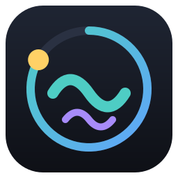

# TidalStudio

A desktop live-coding editor for [TidalCycles](https://tidalcycles.org), built with C#, .NET 10 and Avalonia 12.
It runs Tidal code the same way the VS Code extension does and adds Strudel-style visual feedback.

## Features

- **Editor** with Tidal syntax highlighting, including separate colours for mini-notation inside strings.
- **Tabs**: open as many files as you like; double-clicking a file in the explorer opens it in a new tab (or
  switches to it). `Ctrl+W` closes a tab (middle-click works too), `Ctrl+Tab` / `Ctrl+Shift+Tab` switch tabs, and
  right-click a tab for Close others / Close all. Modified tabs show a dot; open tabs are reopened next time.
- **Autocomplete** while typing (or with `Ctrl+Space`):
  - Tidal functions with their type signatures, read from your installed Tidal when it starts, plus short
    descriptions of the common ones. After `#`, effects such as `room` and `lpf` are preferred.
  - Sample names inside `s "…"` / `sound "…"`, from your Dirt-Samples folder and every folder your SuperCollider
    `startup.scd` loads with `~dirt.loadSoundFiles("…")` (with the number of samples in each), plus SuperDirt's synths.
  - Inline visuals after `-- _`, then their options (`-- _pianoroll cyc` → `cycles=`), then the allowed values
    (`rows=` → `pitch` / `sound`).

  `Enter` or `Tab` accepts a suggestion; `Enter` after a word that is already complete just starts a new line.
  Turn it off with View ▸ Autocomplete while typing.
- **Running code** like in VS Code:
  - `Shift+Enter`: run the current line
  - `Ctrl+Enter`: run the block around the cursor (lines between blank lines), or the selection
  - `Ctrl+.` or `Ctrl+Alt+H`: hush
  - `Ctrl+1` … `Ctrl+9`: mute or unmute `d1` … `d9`

  The code that ran flashes green (or red on an error). Errors are marked on the line they came from and shown in the
  status bar and console.
- **Mini-notation highlighting**: the characters of the mini-notation that are sounding right now light up, one
  colour per pattern. You can override the colour with `# color "orange"` or `# color "ff8800"` (hex without `#`,
  because `#` isn't allowed inside Tidal strings). Style: background, outline or underline (View ▸ Highlight style).
- **Visualizer panel**:
  - **Cycle progress**: where Tidal's clock is: position in the cycle, beat, cycle number, cps/bpm, a lane per
    pattern with its onsets, and progress through an N-cycle phrase.
  - **Punchcard / Pianoroll**: scrolling rows per sound or per pitch. Options include cycles shown, playhead
    position, labels, colours, vertical layout and folding.
  - **Spiral**: one turn per cycle, the past spiralling inward. Options include size, thickness, stretch, playhead
    and rotation.
  - **Pitchwheel**: sounding notes on a one-octave circle (flake, polygon or dots), with trails.
  - **Scope**: audio waveform with a rising-edge trigger.
  - **Spectrum**: FFT analyser with a log or linear axis, dB range, smoothing and peak hold.
  - **Rings**: one ring per pattern (or per sound) with the onsets of the current cycle joined into a shape, so
    polyrhythms and euclidean rhythms read at a glance; a hand sweeps round.
  - **Parameter plot**: one control (lpf, pan, speed, room, …) over the last few cycles, a line per pattern, so
    modulation like `# lpf (range 200 2000 sine)` becomes visible. Steps, lines or dots; optional log scale.
  - **Channels**: a mixer-like bar per pattern that jumps on every hit (height = gain) and falls back, with its sounds
    and hits per cycle.
  - **Stereo field**: each hit as a dot by pan (left to right) and pitch, gain, orbit or pattern; shows `jux` and
    `# pan sine` nicely.
  - **Spectrogram**: scrolling frequency waterfall of the audio, with inferno, ocean or mono colours.
  - **Level meter**: peak and RMS bars with peak hold, plus a loudness history.

  Every tile has an ⚙ options panel and a resize grip. **behind code** also draws that visualizer behind the
  editor text.
- **Inline visuals** (like Strudel's `_pianoroll()`): add a comment at the start of a line in a block:

  ```haskell
  d3 $ n "0 [3 7] <5 10> 12" # s "superpiano"
    -- _pianoroll cycles=2 height=120
  ```

  This works with every visualizer: `_punchcard`, `_pianoroll`, `_spiral`, `_pitchwheel`, `_scope`, `_spectrum`,
  `_cycle`, `_rings`, `_params`, `_channels`, `_stereo`, `_spectrogram` and `_meter` (e.g. `-- _params param=pan`).
  Options go after the name as `key=value` (the same keys as in the ⚙ panel, plus `width` and `height`).
  An inline visual only shows the patterns of its own block.
- **File explorer and working directory**: the explorer (View ▸ Show file explorer, `Ctrl+Shift+E`) shows the
  working directory. Double-click a file to open it; right-click for New Tidal file, Set as working directory, Show in
  file manager and Copy path. The working directory is also ghci's current directory (changed live, so patterns keep
  playing), where `BootTidal.hs` is looked for if there is none next to the file, and where file dialogs open. Set it
  with File ▸ Set working directory… or the folder button in the explorer.
- **Loading screen** while Tidal boots at launch. GHC itself needs about 5 seconds to start on Windows (even
  `ghc -e "print 1"` takes that long), so this can't be made much faster; the editor is usable as soon as the screen
  closes, or press Esc to skip it.
- **SuperDirt starts automatically**: at launch and whenever you run code, TidalStudio checks that SuperDirt answers
  (the same handshake Tidal uses) and starts SuperCollider + SuperDirt if it doesn't. The status bar shows
  SuperDirt's state. If your `startup.scd` already starts SuperDirt, that is used as is. A SuperDirt started by
  TidalStudio is stopped again when TidalStudio closes. Turn it off under SuperCollider ▸ Start SuperDirt
  automatically; SuperCollider ▸ Start SuperDirt starts it by hand, recent files, and settings saved to
  `%APPDATA%\TidalStudio\settings.json`.

## Requirements

- GHC with the `tidal` package (`cabal install tidal --lib`). TidalStudio finds `ghci` on PATH (it re-reads PATH
  from the registry, so a PATH change after login is picked up) or under `C:\tools\ghc-*`, ghcup and similar
  locations. You can also choose it via Tidal ▸ Choose ghci….
- SuperCollider with SuperDirt.
- Windows for the audio visualizers (WASAPI loopback). Everything else is plain Avalonia and should also run on
  macOS and Linux.

## Build, run, publish

```sh
dotnet build
dotnet test
dotnet run --project src/TidalStudio.App -- path/to/file.tidal

# One self-contained TidalStudio.exe (no .NET install needed):
dotnet publish src/TidalStudio.App -c Release -r win-x64 -o publish/win-x64
```

## How it works

```
 editor ──(code, string literals wrapped as (tsctx ID "…"))──▶ ghci + Tidal ──OSC──▶ SuperDirt :57120
                                                                     │
                                                                     └──OSC (same events)──▶ TidalStudio :57130
                                                                                               │
              event store + cycle clock ◀─────────────────────────────────────────────────────┘
                     │
   highlighting, punchcard, pianoroll, spiral, pitchwheel, cycle progress
   WASAPI loopback ──▶ ring buffer ──▶ scope, spectrum
```

- **Boot file.** TidalStudio's `BootTidal.hs` (in `src/TidalStudio.Core/Resources`) is the standard one plus:
  - a second OSC target, so every event also goes to the editor on UDP 57130 as a timestamped bundle;
  - `tsVis`, applied by `p`/`d1…d16`, which copies each event's source positions into a `_ctx` parameter;
  - the `TsCtx` class (`tsctx`), which attaches positions to patterns and leaves plain strings and pattern IDs alone;
  - `color` / `colour`.

  It stays compatible with VS Code and other editors. Without TidalStudio running, the extra UDP packets are simply
  dropped.
- **Which boot file is used.** By default TidalStudio uses `BootTidal.hs` next to the open file (or in a parent
  folder), like the VS Code extension does, and otherwise its built-in one. If that file lacks the additions, the
  console says so. Tidal ▸ Boot file can switch to the built-in file, or write it next to your `.tidal` file.
- **Highlighting.** Before code is sent, each string literal becomes `(tsctx ID "…")`. Tidal shifts the literal's
  mini-notation positions to line `ID + 1`. The editor keeps a text anchor per ID, so positions follow your edits
  until you change the literal itself. If wrapping breaks a piece of code (a string used where `tsctx` has no
  instance), it is run again unchanged.
- **Clock.** Tidal owns the clock. The cycle position is derived from the `cycle`, `cps` and time tag of incoming
  events and extrapolated between them.

## Limitations

- Tidal only sends events about 50 ms ahead, so the future side of the punchcard and pianoroll shows a faint
  repeat of the last cycle rather than the real upcoming events. You can turn this off per tile.
- Audio capture records everything Windows plays, not only SuperCollider.
- Strings with escape characters (`\"`) aren't highlighted.

## Development

The logo, app icon and in-app logo are generated by one script: `dotnet run tools/logo/MakeLogo.cs` writes
`tools/logo/logo.svg`, `src/TidalStudio.App/Assets/logo.png` and `src/TidalStudio.App/Assets/TidalStudio.ico`.

`TidalStudio.exe --selftest <dir> [file.tidal]` starts Tidal, runs every block of the file (or the welcome sample),
sends real Shift+Enter / Ctrl+Enter / Ctrl+. key events, writes `selftest.log` and screenshots to `<dir>`, and exits.
Set `TIDALSTUDIO_SETTINGS` to a separate settings file (for example one whose `BootFilePath` points to a boot file
with the SuperDirt port changed) to test without sound. If another TidalStudio is open it holds UDP 57130, so also
give the test its own `EditorOscPort` and change `57130` in that boot file to match.

`--test-signal` replaces audio capture with a synthetic signal (kick, hats and a rising tone) written straight into
the analysis buffer, so the scope, spectrum, spectrogram and level meter can be checked without playing anything.
